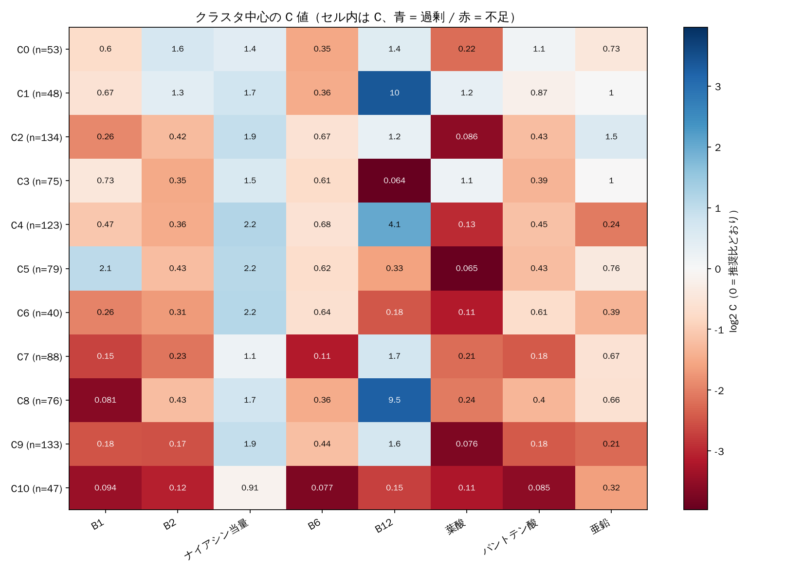
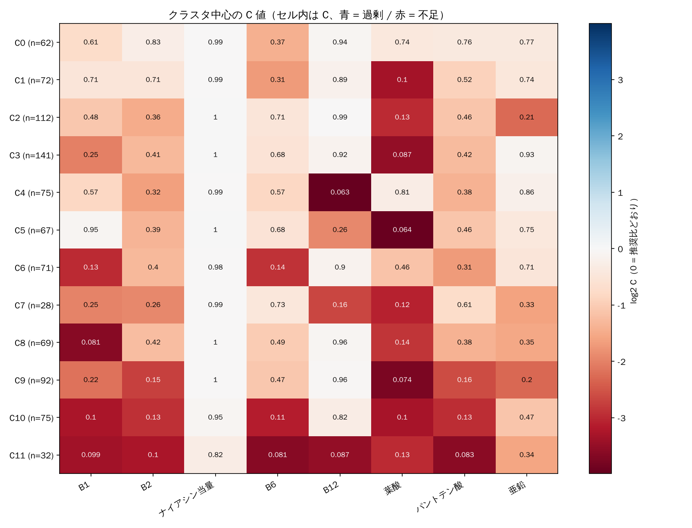
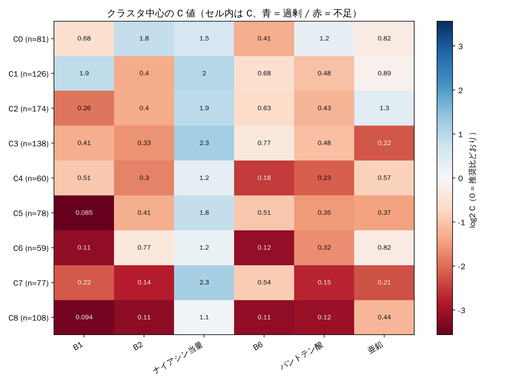
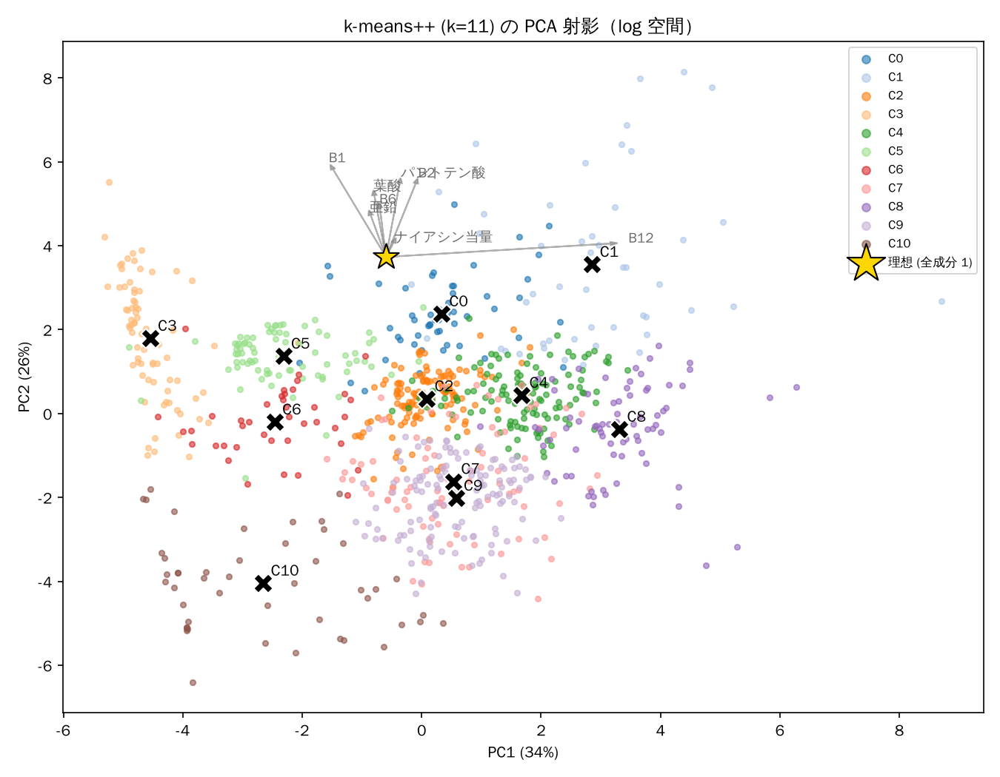
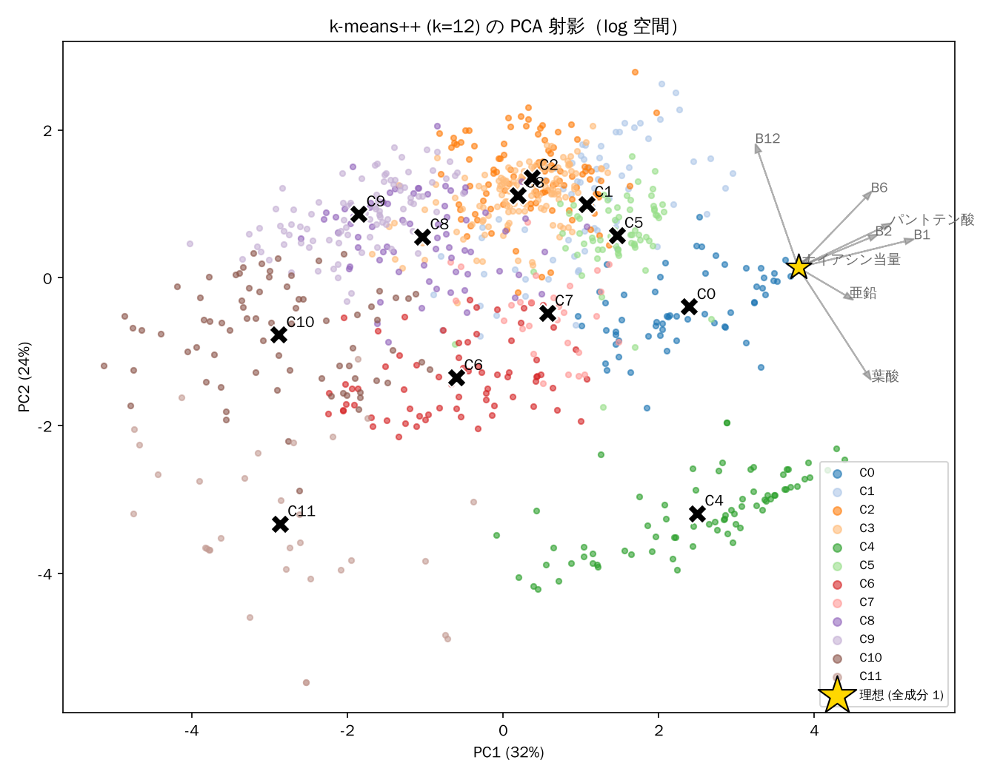
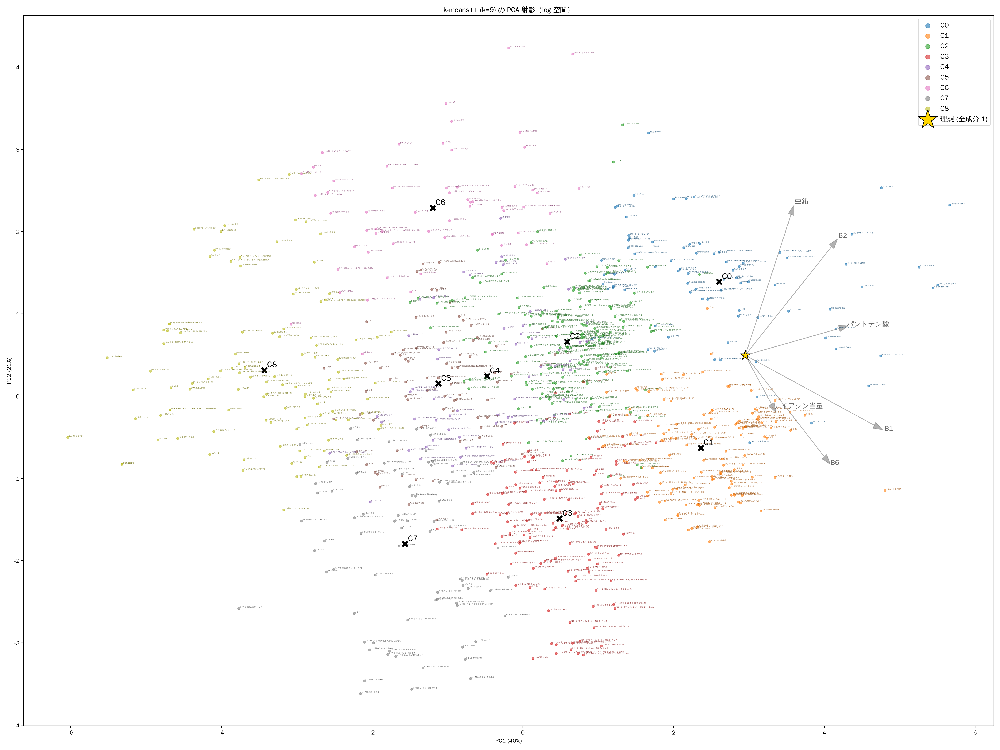
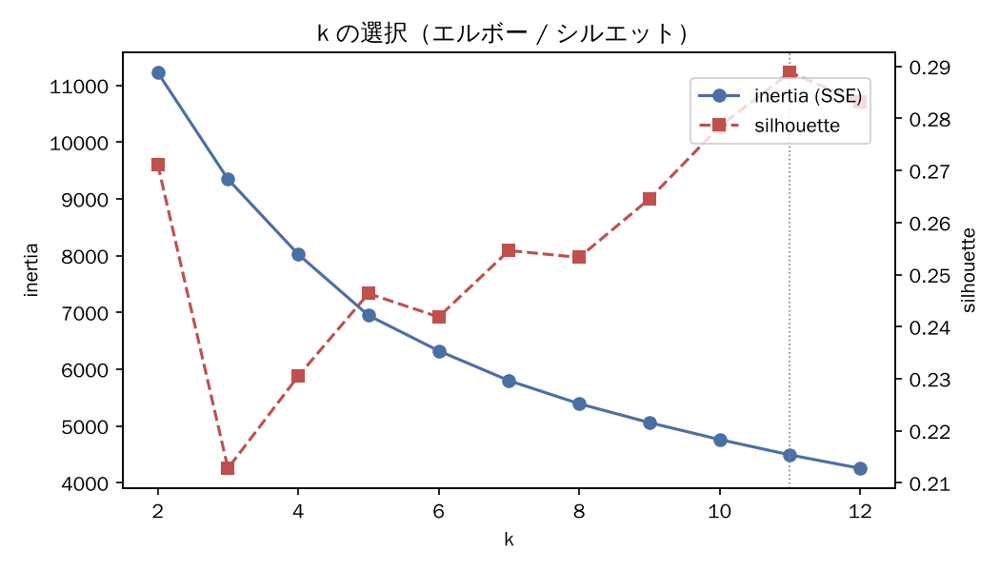
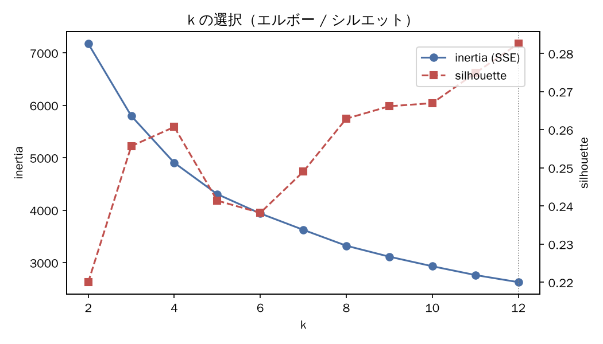
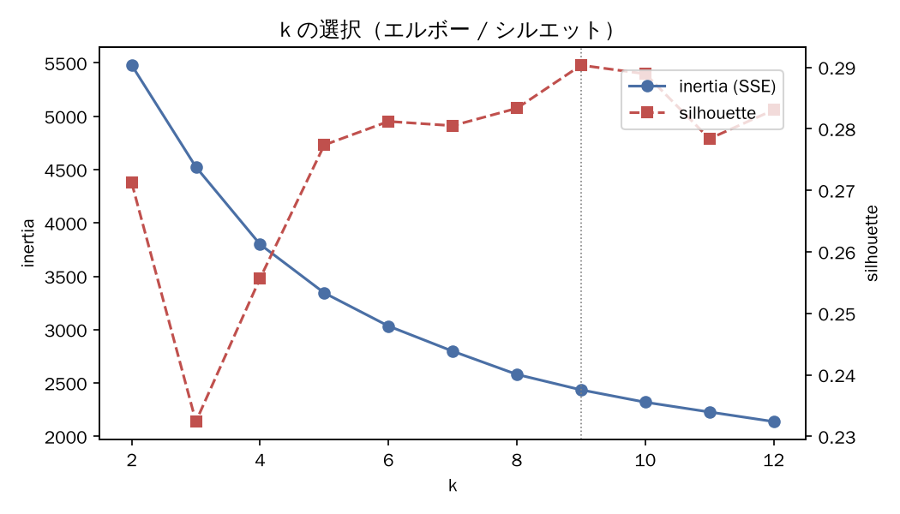

# 解析結果

この文書は、高たんぱく食材の $C_{i,\alpha}$（たんぱく質あたりの栄養充足比）を k-means++ でクラスタリングした 3 つの解析の結果をまとめたものです。
記号の定義・データの出典・前処理の詳細は [README.md](README.md) を参照してください。

| 解析 | 定義 | 結果ディレクトリ | 再現コマンド |
|---|---|---|---|
| 解析 1 | $C_{i,\alpha}$（上限なし） | `results/log/` | `python3 src/analysis.py` |
| 解析 2 | $\min(1, C_{i,\alpha})$ | `results/log_cap1/` | `python3 src/analysis.py --cap 1.0` |
| 解析 3 | $C_{i,\alpha}$（上限なし）、B12 と葉酸を除く 6 栄養素 | `results/log_noVITB12_noFOL/` | `python3 src/analysis.py --exclude VITB12,FOL` |

## 共通の条件

- **対象食品: 896 件**（乳類 45 件、卵類 23 件を含む）
  - 豆類・種実類・魚介類・肉類: たんぱく質 10 g/100 g 以上
  - 卵類・乳類: 牛乳（3.3 g）やヨーグルト（3.6〜4.0 g）を含めるため、3 g/100 g 以上
  - 乳児用調製粉乳はビタミン強化品なので除外
  - 対象栄養素に欠測がある 9 件は除外
- **栄養素（8 種）:** B1、B2、ナイアシン当量、B6、B12、葉酸、パントテン酸、亜鉛
  - ビオチンは対象食品の半数以上で未測定のため除外（`--with-biotin` で追加できる）
- **推奨量:** 日本人の食事摂取基準（2025年版）の 18〜29 歳の値
  - B12 とパントテン酸は推奨量がないため目安量を使う
- **クラスタリング空間:** $\log_2 C$。理想点（全成分 1）は原点になる
  - C のままでは B12 が数百倍まで振れ、外れ値 1 件が単独クラスタになった（`results/raw/` は参考用）
  - 対数にすると「2 倍過剰」と「1/2 不足」が同じ重みで扱われる
  - C = 0（植物性食品の B12 など）は 1/16 に置き換えてから対数を取る。植物性食品の理想点からの距離は、この設定に大きく左右される
- **k の選択:** k = 2〜12 のうちシルエット係数が最大のものを採用（k-means++、n_init = 100、seed = 0）
- **クラスタ番号:** 中心が理想点に近い順に 0, 1, … と付けている
- **食品ごとの指標**（`foods_clustered.csv`）
  - `dist_to_ideal`: log₂ 空間での理想点との距離
  - `shortfall_rms_log2`: 不足分だけで計算した距離の目安
  - `n_satisfied`: C ≥ 1 となる栄養素の数

---

## 解析 1: $C_{i,\alpha}$（上限なし）

### k の選択

採用したのは **k = 11** です。
ただし、シルエット係数はどの k でも 0.21〜0.29 と低く、はっきり分かれた群というより連続的な分布です。

| k | 2 | 3 | 4 | 5 | 6 | 7 | 8 | 9 | 10 | 11 | 12 |
|---|---|---|---|---|---|---|---|---|---|---|---|
| シルエット | 0.271 | 0.213 | 0.230 | 0.246 | 0.242 | 0.255 | 0.253 | 0.265 | 0.278 | **0.289** | 0.283 |

### クラスタ中心（C の値）

| クラスタ | 件数 | B1 | B2 | ナイアシン | B6 | B12 | 葉酸 | パントテン酸 | 亜鉛 | 主な食品群（件数） |
|---|---|---|---|---|---|---|---|---|---|---|
| 0 | 53 | 0.60 | 1.60 | 1.38 | 0.35 | 1.41 | 0.22 | 1.10 | 0.73 | 乳 24・卵 11・肉 10・魚 8 |
| 1 | 48 | 0.67 | 1.34 | 1.74 | 0.36 | 10.32 | 1.25 | 0.87 | 1.02 | 魚介 33・肉 9・卵 6 |
| 2 | 134 | 0.26 | 0.42 | 1.93 | 0.67 | 1.24 | 0.09 | 0.43 | 1.49 | 肉 131 |
| 3 | 75 | 0.73 | 0.35 | 1.52 | 0.61 | 0.06 | 1.14 | 0.39 | 1.00 | 豆 44・種実 28 |
| 4 | 123 | 0.47 | 0.36 | 2.24 | 0.68 | 4.08 | 0.13 | 0.45 | 0.24 | 魚介 120 |
| 5 | 79 | 2.08 | 0.43 | 2.15 | 0.62 | 0.33 | 0.07 | 0.43 | 0.76 | 肉 75 |
| 6 | 40 | 0.26 | 0.31 | 2.20 | 0.64 | 0.18 | 0.11 | 0.61 | 0.39 | 肉 36 |
| 7 | 88 | 0.15 | 0.23 | 1.15 | 0.11 | 1.65 | 0.21 | 0.18 | 0.67 | 魚介 58・肉 14・乳 11 |
| 8 | 76 | 0.08 | 0.43 | 1.69 | 0.36 | 9.50 | 0.24 | 0.40 | 0.66 | 魚介 76 |
| 9 | 133 | 0.18 | 0.17 | 1.92 | 0.44 | 1.63 | 0.08 | 0.18 | 0.21 | 魚介 131 |
| 10 | 47 | 0.09 | 0.12 | 0.91 | 0.08 | 0.15 | 0.11 | 0.09 | 0.32 | 豆 17・魚介 16・乳 6 |

### クラスタの特徴

| クラスタ | 主な食品 | 特徴 |
|---|---|---|
| 0 | ヨーグルト、牛乳、全卵 | 理想に最も近い。B2 とパントテン酸は充足、B6（0.35）と葉酸（0.22）は不足 |
| 1 | 卵黄、うずら卵、うに、貝類など | B12 が非常に多く（約 10 倍）、他の栄養素もほぼ充足 |
| 2 | 牛肉など | 亜鉛は充足、葉酸（0.09）が大きく不足 |
| 3 | 豆類・種実類 | 葉酸と亜鉛は充足、B12 はほぼゼロ |
| 4 | あゆ、子持ちがれいなどの魚 | B12 は豊富、亜鉛（0.24）と葉酸が不足 |
| 5 | 豚肉系 | B1 が目標の約 2 倍 |
| 6 | 鶏肉（むね・もも・ささみ） | B12・葉酸・亜鉛が不足 |
| 7 | チーズ、豚胃・砂肝などの副生物、えび、ほたて貝柱 | B1・B6・パントテン酸が大きく不足 |
| 8 | かに、ばい貝、さば缶、あみ佃煮 | B12 は豊富、B1 がほぼゼロ |
| 9 | あなご、たら、かれい、はもなどの白身魚 | B1・B2・葉酸・亜鉛が不足 |
| 10 | クリーム類、湯葉、がんもどき | たんぱく質に対して全栄養素が低い |

### 個別食品

- **理想点に最も近い食品:** 無脂肪無糖ヨーグルト（距離 1.82）、全脂無糖ヨーグルト（2.08）、低脂肪無糖ヨーグルト（2.19）、ゆで卵黄（2.21）、牛乳（2.44）、全卵 生（2.57）
- **不足だけを見た場合:** 豚レバー、豚腎臓、鶏レバーは 8 栄養素すべてで C ≥ 1
- **植物性で最も不足が小さい食品:** ヘーゼルナッツ、えごま、ひまわりの種、ピスタチオ、挽きわり納豆（`shortfall_rms_log2` 1.42〜1.50）。不足の主因は B12 がゼロであること

---

## 解析 2: $\min(1, C_{i,\alpha})$（過剰分を評価しない）

### k の選択

採用したのは **k = 12** です。
探索範囲の上限だったため、k = 20 まで広げて確認しました。k = 12 以降のシルエット係数は約 0.28〜0.29 で横ばいでした。
k = 13 が 0.295 でわずかに高いものの差は小さいため、k = 12 のままにしています。
解析 1 と同様、連続的な分布です。

| k | 2 | 3 | 4 | 5 | 6 | 7 | 8 | 9 | 10 | 11 | 12 | 13 | 14〜20 |
|---|---|---|---|---|---|---|---|---|---|---|---|---|---|
| シルエット | 0.220 | 0.256 | 0.261 | 0.241 | 0.238 | 0.249 | 0.263 | 0.266 | 0.267 | 0.275 | **0.283** | 0.295 | 0.283〜0.290 |

### クラスタ中心（C の値、上限 1）

| クラスタ | 件数 | B1 | B2 | ナイアシン | B6 | B12 | 葉酸 | パントテン酸 | 亜鉛 | 主な食品群（件数） |
|---|---|---|---|---|---|---|---|---|---|---|
| 0 | 62 | 0.61 | 0.83 | 0.99 | 0.37 | 0.94 | 0.74 | 0.76 | 0.77 | 魚介 33・卵 15・肉 8・乳 6 |
| 1 | 72 | 0.71 | 0.71 | 0.99 | 0.31 | 0.89 | 0.10 | 0.52 | 0.74 | 肉 35・魚介 20・乳 16 |
| 2 | 112 | 0.48 | 0.36 | 1.00 | 0.71 | 0.99 | 0.13 | 0.46 | 0.21 | 魚介 107 |
| 3 | 141 | 0.25 | 0.41 | 1.00 | 0.68 | 0.92 | 0.09 | 0.42 | 0.93 | 肉 126・魚介 15 |
| 4 | 75 | 0.57 | 0.32 | 0.99 | 0.57 | 0.06 | 0.81 | 0.38 | 0.86 | 豆 45・種実 28 |
| 5 | 67 | 0.95 | 0.39 | 1.00 | 0.68 | 0.26 | 0.06 | 0.46 | 0.75 | 肉 64 |
| 6 | 71 | 0.13 | 0.40 | 0.98 | 0.14 | 0.90 | 0.46 | 0.31 | 0.71 | 魚介 47・乳 12 |
| 7 | 28 | 0.25 | 0.26 | 0.99 | 0.73 | 0.16 | 0.12 | 0.61 | 0.33 | 肉 27 |
| 8 | 69 | 0.08 | 0.42 | 1.00 | 0.49 | 0.96 | 0.14 | 0.38 | 0.35 | 魚介 67 |
| 9 | 92 | 0.22 | 0.15 | 1.00 | 0.47 | 0.96 | 0.07 | 0.16 | 0.20 | 魚介 90 |
| 10 | 75 | 0.10 | 0.13 | 0.95 | 0.11 | 0.82 | 0.10 | 0.13 | 0.47 | 魚介 61 |
| 11 | 32 | 0.10 | 0.10 | 0.82 | 0.08 | 0.09 | 0.13 | 0.08 | 0.34 | 豆 17・魚介 7 |

### クラスタの特徴

| クラスタ | 主な食品 | 特徴 |
|---|---|---|
| 0 | レバー・腎臓、卵黄、全卵、牛乳、無糖ヨーグルト、うなぎきも | ほぼ全栄養素が 0.6〜1。主な不足は B6（0.37） |
| 1 | 牛心臓、鴨、ソーセージ、乳製品 16 件 | 葉酸（0.10）が大きく不足 |
| 2 | さば、あゆなどの魚 | 亜鉛（0.21）と葉酸が不足 |
| 3 | 牛肉 | 葉酸（0.09）が不足、亜鉛はほぼ充足 |
| 4 | 豆類・種実類（納豆、ナッツ） | B12（0.06）がほぼゼロ、葉酸と亜鉛は比較的良い |
| 5 | 豚肉 | B1 はほぼ充足（0.95）、B12 と葉酸が不足 |
| 6 | あみ、かに、チーズ、うずら卵水煮缶 | B1・B6 が大きく不足 |
| 7 | 鶏肉 | B12・葉酸・亜鉛が不足 |
| 8 | いわし、さば缶、かに | B1 がほぼゼロ |
| 9 | あじ、まぐろ、さけ | B2・葉酸・パントテン酸・亜鉛が不足 |
| 10 | たら、えび、豆腐竹輪 | ナイアシンと B12 以外が軒並み不足 |
| 11 | 湯葉、がんもどき、大豆たんぱく、伊勢えび | 理想点から最も遠い |

### 個別食品

- **距離 0（8 栄養素すべて充足）:** 豚レバー、豚腎臓、鶏レバー
- **それに続く食品:** うなぎきも（0.29）、レバーペースト（0.47）、卵黄 生（0.49）、牛レバー（0.55）
- **乳類・卵類:** 卵黄 生（0.49）、うずら卵（1.35）、無脂肪無糖ヨーグルト（1.60）、牛乳（2.07）、全卵 生（2.51）
- **植物性で最も近い食品:** 挽きわり納豆（4.23）、りょくとう（4.30）、ひよこまめ（4.35）。B12 がゼロのため、解析 1 と同様に理想点から離れている

---

## 解析 3: $C_{i,\alpha}$（上限なし、B12・葉酸を除外）

**栄養素（6 種）:** B1、B2、ナイアシン当量、B6、パントテン酸、亜鉛

B12 と葉酸の欠測で除外されていた食品が戻ったため、**対象食品は 901 件**になった（欠測除外は 4 件）。
B12 がゼロのために理想点から遠ざけられていた植物性食品の扱いが、解析 1・2 と大きく変わる。

### k の選択

採用したのは **k = 9** です。
シルエット係数は k = 5 以降 0.28〜0.29 でほぼ横ばいで、解析 1・2 と同じく連続的な分布です。

| k | 2 | 3 | 4 | 5 | 6 | 7 | 8 | 9 | 10 | 11 | 12 |
|---|---|---|---|---|---|---|---|---|---|---|---|
| シルエット | 0.271 | 0.232 | 0.256 | 0.277 | 0.281 | 0.281 | 0.283 | **0.290** | 0.289 | 0.278 | 0.283 |

### クラスタ中心（C の値）

| クラスタ | 件数 | B1 | B2 | ナイアシン | B6 | パントテン酸 | 亜鉛 | 主な食品群（件数） |
|---|---|---|---|---|---|---|---|---|
| 0 | 81 | 0.68 | 1.79 | 1.51 | 0.41 | 1.23 | 0.82 | 乳 23・魚介 21・肉 18・卵 15・豆 3 |
| 1 | 126 | 1.88 | 0.40 | 2.01 | 0.68 | 0.48 | 0.89 | 肉 78・豆 23・種実 18・魚介 7 |
| 2 | 174 | 0.26 | 0.40 | 1.91 | 0.63 | 0.43 | 1.33 | 肉 141・魚介 16・豆 9・種実 8 |
| 3 | 138 | 0.41 | 0.33 | 2.32 | 0.77 | 0.48 | 0.22 | 魚介 115・肉 22 |
| 4 | 60 | 0.51 | 0.30 | 1.24 | 0.18 | 0.23 | 0.57 | 魚介 37・豆 14・肉 7 |
| 5 | 78 | 0.08 | 0.41 | 1.81 | 0.51 | 0.35 | 0.37 | 魚介 73 |
| 6 | 59 | 0.11 | 0.77 | 1.18 | 0.12 | 0.32 | 0.82 | 魚介 26・乳 15・肉 11 |
| 7 | 77 | 0.22 | 0.14 | 2.29 | 0.54 | 0.15 | 0.21 | 魚介 74 |
| 8 | 108 | 0.09 | 0.11 | 1.07 | 0.11 | 0.12 | 0.44 | 魚介 80・豆 15・肉 7 |

### クラスタの特徴

| クラスタ | 主な食品 | 特徴 |
|---|---|---|
| 0 | 卵黄、全卵、ヨーグルト、牛乳、やぎ乳、糸引き納豆、合鴨、ほたるいか | 理想に最も近い。B2 とパントテン酸は充足、B6（0.41）と B1（0.68）が不足 |
| 1 | 豚肉、豆類（りょくとう・ひよこまめ・大豆）、ナッツ、あひる | B1 が約 2 倍。B2 とパントテン酸が不足 |
| 2 | 牛肉、羊肉、鹿肉、はまぐり | 亜鉛は充足（1.33）、B1・B2・パントテン酸が不足 |
| 3 | さば、あゆ、さけ、鶏肉 | 亜鉛（0.22）が大きく不足 |
| 4 | おきあみ、さくらえび、とこぶし、大豆たんぱく | B6（0.18）とパントテン酸（0.23）が不足 |
| 5 | いわし、さば缶 | B1（0.08）がほぼゼロ |
| 6 | チーズ、ほたて、かじか、あさり佃煮 | B2 と亜鉛は比較的良いが、B1（0.11）と B6（0.12）が大きく不足 |
| 7 | あじ、まぐろ、かじき、かつお | B2・パントテン酸・亜鉛が不足 |
| 8 | たら、いか、たこ、えび、がんもどき・油揚げ | たんぱく質に対して全栄養素が低い |

### 個別食品

- **理想点に最も近い食品:** ヘーゼルナッツ フライ 味付け（距離 0.69）、合鴨（1.20）、ほたるいか（1.26）、ゆで卵黄（1.27）、卵黄 生（1.43）
- **乳類・卵類:** やぎ乳（1.51）、全脂無糖ヨーグルト（1.54）、うずら卵（1.84）、牛乳（1.91）、全卵 生（2.54）
- **植物性:** りょくとう（1.76）、ひよこまめ（1.77）、くるみ（1.80）、黄大豆（1.92）、レンズまめ（1.93）、糸引き納豆（2.51）
- **不足なし（6 栄養素すべてで C ≥ 1）:** 豚腎臓、鶏レバー、豚レバー。ただし上限なしなので、B2 などの大幅な過剰が距離に効き、理想点の近くには来ない
- 鶏むね肉（皮なし）は 4.2〜4.7 と遠く、たんぱく質の割に B 群と亜鉛が少ない

---

## 3 つの解析の比較

- **貝類・肝類の位置:** 解析 1 では、B12 の大幅な過剰（10 倍前後）が「理想からのずれ」として距離に効いていた。解析 2 では過剰が評価されないため、貝類・肝類が理想側へ寄った。
- **最上位クラスタの中身:**
  - 解析 1 では、乳・卵中心のクラスタ 0 が最も理想に近かった。
  - 解析 2 では、臓物と乳・卵が同じクラスタ 0 にまとまった。
  - 不足の少なさだけで見れば、レバー類が最良で、乳・卵がそれに次ぐ。
- **植物性食品:** 解析 1・2 では、B12 がほぼゼロであることが理想点から離れる主因だった。B12 と葉酸を除いた解析 3 では、豆類・ナッツが理想点の近くに来る（ヘーゼルナッツが全食品で最も近く、りょくとう・ひよこまめ・大豆が 1.8〜1.9）。また、豆類は豚肉と同じクラスタ（B1 が多く、B2 とパントテン酸が少ない）にまとまる。
- **乳・卵:** 3 つの解析すべてで、最も理想に近いクラスタに入っている。
- **クラスタの分かれ方:** いずれの解析もシルエット係数は 0.3 未満。食品は連続的に分布しており、クラスタは「似た栄養の偏りをもつ食品のまとまり」として読むのが適切。

## 図

| | 解析 1 | 解析 2 | 解析 3 |
|---|---|---|---|
| クラスタ中心ヒートマップ |  |  |  |
| PCA 射影と理想点（各点に食品名。拡大して読む場合は同じフォルダの `pca_clusters.pdf`） |  |  |  |
| k の選択 |  |  |  |
